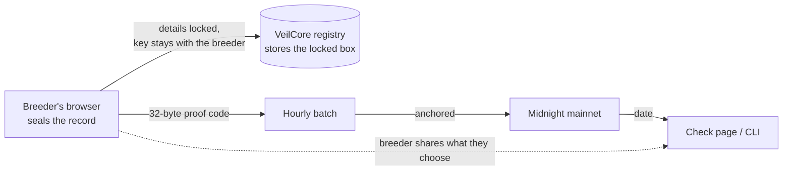

# VeilCore

Dated, private records for plant and animal genetics, on Midnight.

A breeder seals a record of a cultivar or an animal line in the browser. The details are
encrypted there, and DNA files are never uploaded. Only a 32-byte proof code is anchored on
Midnight, in a batch with others. Later a buyer, examiner or court can check what the record
said and when it existed: free, no account, without having to trust us.
(What our server can still see: [the list](#what-leaves-your-browser).)

**[veilcore.org](https://veilcore.org)** runs on Midnight mainnet ·
[test.veilcore.org](https://test.veilcore.org) is for practice ·
the record format is an open spec: [veilcore-sdk](https://github.com/hunterincoming/veilcore-sdk)



## Try it

1. **See a check page, nothing to install:** [veilcore.org/verify/example](https://veilcore.org/verify/example)
   walks through what a stranger sees when they check a record, line by line.
2. **Check a record yourself, offline:**

   ```bash
   curl -sO https://raw.githubusercontent.com/hunterincoming/veilcore-sdk/main/examples/record.json
   npx veilcore-records verify record.json
   ```

   It prints `commitment holds` and `Verified.` (exit 0). Edit the record's name in the file and it
   prints `DOES NOT HOLD` with both fingerprints (exit 1). Full output in the
   [veilcore-sdk README](https://github.com/hunterincoming/veilcore-sdk#try-it-in-30-seconds).
3. **Make a practice record:** [test.veilcore.org](https://test.veilcore.org): no wallet, no
   account, on a Midnight test network.

## On mainnet since 8 October 2026

| Contract | Address | Can it be changed? |
|---|---|---|
| `veilcore.compact`: records, licenses, lineage (24 circuits) | `a04de0a2684f3713276325649540c7278ffd07cba8b014e7489844f319a02347` | By a maintenance key ([policy](docs/maintenance-policy.md)) |
| `veilcore-claims.compact`: prove one fact about sealed values | `ef763eb4ad1846b716dbfa90c00560a9a943ffb4d1fc638b0707df5adefd070d` | No. It has no maintenance key |

Deploy transactions and blocks: [the deployment record](docs/deployment-record-revision-4.md#mainnet-deployment).
Build fingerprints: [docs/fingerprints.md](docs/fingerprints.md).

## Where it stands

- **Works on veilcore.org:** sealing records; batches anchored on mainnet automatically, every
  hour (the first batch, `B-20261011-FE71`, is also stamped on Bitcoin, blocks 971004 and
  971005); proving a record by link; dating a DNA report pairing from the browser; lab receipts
  and reports signed with the lab's own key; choosing what a record's check page shows; check
  pages that read the date from Midnight themselves. No wallet needed: VeilCore's fee service
  pays the network fee for what the browser sends.
- **Licenses and royalties: built, live on the test network, switched off on veilcore.org
  until a final test run.** On [test.veilcore.org](https://test.veilcore.org) a breeder
  licenses a record to a grower with real transactions: two devices, a 6-digit code read
  aloud, a private signed channel per deal for terms and royalty statements, payment straight
  from payer to payee (VeilCore never holds money), royalties on declared offspring, handing a
  license on with the breeder's approval, and a pack a lender can check with a free tool.
  Lab hand-overs and breeder shares work the same way.
  [docs/agreements-live.md](docs/agreements-live.md)
- **Five languages:** English, plus Spanish, Japanese, German and French as drafts on the test
  site until a fluent speaker signs each off ([how](docs/translations/README.md)).
- **No audit.** Twelve rounds of adversarial review are public, with the attacks kept as tests
  ([docs/security-pass-30sep.md](docs/security-pass-30sep.md)). They are not a formal audit.
- **Open to first users** since 20 October 2026. Every record so far is our own test data.
- **No token.** VeilCore has never sold a token, coin or presale. Anyone offering one in
  VeilCore's name is not us.

A record is evidence you held a description by a date. It isn't ownership, it doesn't test
DNA, and we don't vouch for any lab. [What VeilCore does not claim](#what-veilcore-does-not-claim).

## What it does

A breeder who holds genetic material may later need to establish three things: that they held it, from a date preceding someone else's acquisition of it, and that material in another party's possession descends from theirs. These are historical claims, ordinarily supported by the holder's own records, which are the weakest evidence available, because it is produced by the party relying on it and can be created after the fact.

Written agreements have a related problem. A contract binds the parties who signed it. It cannot bind a plant that did not exist when it was signed, which is why a cutting that becomes a mother that becomes ten thousand clones carries no obligation anyone can point at.

VeilCore records what was held and when, lets licenses be granted against a record, and lets an obligation on an ancestor be carried by everything derived from it.

- **Prove prior possession:** an anchored record is dated by the block its batch lands in.
- **Pair a DNA report:** record a DNA report against your record. The contract binds whatever 32-byte value the holder submits: it is the holder's own statement that this report belongs to this record, not a check of the genetics. The client submits a salted binding of the report's hash to the record's identity, not the raw hash, so the pairing cannot be copied to another record. It shows that whoever controlled the record's identity at that date had the report, or its SHA-256, by then (verifier rule 9 in [`docs/design.md`](docs/design.md), which also flags a report hash paired raw earlier and key changes since). The web app keeps the pairing in the registry, not on chain.
- **License against the record:** on chain a license is only PENDING (issued) or ACTIVE (countersigned), and revoking removes it. The contract stores no terms and has no expiry. The terms, statements and payment records travel between the two sides over a private channel: each message is signed by its sender and locked so the registry, which relays it, can't read or change it. A presentation proves "a live license from this issuer", not which license or on what terms.
- **Prove a claim without showing the secret:** prove you hold a record, or a license, without revealing the secret behind it. A control proof publishes the record's commitment. A license presentation hides the license and the licensee, and the issuer only among issuers with live licenses; while only one issuer has live licenses, as at launch, it names that issuer.

Plant genetics is the first use, not the limit. The record format is domain-blind: the same envelope serves ornamental propagation, a livestock herd book, or a microbial culture collection.

## What leaves your browser

- **Sealed in the browser.** Everything a holder types into a record or license (name,
  breeder, species, dates, notes, reference numbers, parents, method, the record's own secret
  keys; a license's counterparty, terms, dates and royalty log) and a delivery's sample
  details are encrypted in the browser (AES-256-GCM) before they are sent.
- **Stored locked; we don't have the key.** The registry (a server we run) stores the locked
  box. The key stays in the holder's browser and backup file. A delivery's sample-details key
  also travels in the lab code, so the lab can open them.
- **DNA files and photos never leave the device.** They are hashed in the browser; the files never leave it. Their fingerprints and the report's file name go to the registry locked, unless the holder chooses to show the DNA pairing
  on a record's check page; then the registry gets only a salted code whose salt travels in the
  holder's check link.
- **Lab reports travel locked**, and are deleted from the registry after 180 days.
- **What the registry can read:** each record's id, profile, proof code and key binding; a
  code made from its name (useless without the salt in the holder's check link); correction
  links; when it first saw the record; save counts and times; a size bucket; what the holder
  chooses to show on its check page; parent links; batch and date stamp; for a license with a
  royalty on offspring, which record carries it and since when (not its terms or parties); for
  a delivery, which record it came from, which holder account received it, and a tag in place
  of the recipient's name; a
  lab's public key and signatures; requests to prove a record's key, kept 7 days.
- **Check links** can carry a record's name and its salt after the `#`. A browser doesn't send
  that part, but the link itself goes whole to whoever receives it.
- **Older data:** text saved before sealing was removed from the registry on 18 October 2026,
  and the off-site backups made before then can no longer be opened: their key was destroyed
  the same day.
- **On chain:** only commitments, plus the public values listed under Known limits in
  [`docs/design.md`](docs/design.md).

VeilCore also serves the app's code, so this is "stored locked, and we don't have the key",
not a promise the code can't change. Every deploy writes a manifest of its files, headers and
build settings (`releases/<network>/<commit>.json`). Anyone can check a live site against it
(`npm run check:site -- <url>`, or `/check-this-site`) and rebuild the release from source to
compare (`npm run check:rebuild -- <manifest>`). That shows what was released; it can't prove
a host sent everyone the same files.

## What this repository is

This is the application: the contract, the API, the CLI and the web app.

The record format itself is a separate, open specification with implementations in TypeScript, Python and Rust (all three written by the same team; an implementation by someone else is still to come): **[veilcore-sdk](https://github.com/hunterincoming/veilcore-sdk)**. Checking a record's fingerprint needs SHA-256 and nothing from this repository or from us. Checking what the contract says (anchors, licenses, lineage) needs Midnight's tooling to read chain state; see Current status.

```
contract/     # The Compact contract (veilcore.compact), verifier rules (verify.ts), tests, hash vectors
api/          # VeilcoreAPI: records, licenses and lineage from a client
bboard-cli/   # CLI for wallet sync and deployment
bboard-ui/    # The web app (React + Vite)
```

> The `bboard-` directory names are inherited from the Midnight scaffold this was forked from. The example code itself has been removed; only the directory names remain, because renaming them touches every relative import for no benefit.

## Running it locally

Requires **Node 24** (`.nvmrc` pins `24.11.1`). No wallet, faucet or Docker needed for the app.

```bash
npm ci                           # from the repo root: installs exactly what package-lock.json pins
cd bboard-ui
npm run dev                      # http://localhost:5173
```

The app opens and you can log a record, but with no registry set it keeps records for that
browser session only. The registry (`veilcore-api`) isn't public yet: to save records, point
the app at one with `VITE_API_BASE=<registry address>`. For a full practice run with a
registry and the test network, use [test.veilcore.org](https://test.veilcore.org).

## Building from a fresh clone

`contract/src/managed/` is gitignored, so a fresh clone has no compiled contract. You need the Compact toolchain, and the packages build in order.

```bash
# 1. Install the Compact toolchain: a fixed installer release, then the compiler version
#    the deployed contract was built with (docs/fingerprints.md). Not "latest" for either.
curl --proto '=https' --tlsv1.2 -LsSf \
  https://github.com/midnightntwrk/compact/releases/download/compact-v0.5.3/compact-installer.sh | sh
# open a new terminal, then:
compact update 0.31.1
compact compile --version        # must print 0.31.1

# 2. Compile the contract (generates contract/src/managed/) and run its tests
cd contract && npm run compact && npm test

# 3. Build in order
cd contract && npm run build
cd ../api && npm run build
cd ../bboard-ui && npm run build
```

## Current status

**Two contracts, both on Midnight mainnet since 8 October 2026** (addresses above). `contract/src/veilcore.compact`
(protocol version 1, frozen) covers records, licenses and lineage. `contract/src/veilcore-claims.compact`
proves one fact about a sealed record without showing the rest (a value, a bound on a number,
that two records differ, that a correction changed only some values), optionally on values a
laboratory signed; see [`docs/claims-design.md`](docs/claims-design.md) and SPEC 4.5 in veilcore-sdk.
The claims contract has no maintenance authority (an empty committee).

The main contract covers records, licenses and lineage in 24 circuits. The design, the normative
verifier rules and the trust model are in [`docs/design.md`](docs/design.md).

An outside developer reviewed it in August. Since then it has had twelve rounds of
attack, recorded in [`docs/security-pass-30sep.md`](docs/security-pass-30sep.md): round 1,
our own pass over both contracts, and rounds 2 to 7 by reviewers who had not seen the
fixes, all on 30 September 2026; then rounds 8 to 12 on 1 October, three of them (8, 11
and 12) followed by a fresh re-attack of their fixes. Round 12 attacked the per-identity state
bounds added that evening (caps on rotations, recoveries, parents, obligations and
licenses; see State bounds in `docs/design.md`). Contract findings were demonstrated against
the build before being fixed or documented. Contract attacks are kept as
tests in `contract/src/test/` (`cd contract && npm test`). Many fixes were in the CLI, the
API, the registry or the website, and are tested there instead: `bboard-cli/src/*.test.ts`
(`cd bboard-cli && npx vitest run`), `api/` (`npm test`), and the registry's
`test/*.test.mjs`. Not every attack has a test. These were adversarial reviews, not a
formal security audit, and we do not call them one.

The six commitment hashes (record, recovery, license, license key, presentation tag,
obligation), and the client's DNA pairing binding, are plain SHA-256 over a tag and their inputs, with published test vectors
(`contract/vectors/v1.json`), so they can be recomputed in any language. The license
tree is not: its inner nodes use Midnight's own field hash, and verifier rule 5 compares
tree roots, so checking a license presentation, like reading any contract state, needs
Midnight's tooling.

**What the web app sends to the chain.** On both sites the browser proves and sends its own
transactions (a record key's date stamp, proving a record by link, dating a DNA pairing) and
a fee service pays the network fee, so nobody needs a wallet. Batches are anchored
automatically by the same service. On test.veilcore.org (preprod) this was first run end to
end on 12 and 13 October 2026 ([`docs/no-wallet-run-12oct.md`](docs/no-wallet-run-12oct.md));
on veilcore.org (mainnet) it went live on 19 October and was checked by hand on 20 October
([`docs/mainnet-sponsor.md`](docs/mainnet-sponsor.md)). Licenses and royalties run with real
transactions on test.veilcore.org and stay switched off on veilcore.org until a final test run.

**The CLI** in `bboard-cli/` talks to a deployed contract. Its smoke test
(`bboard-cli/src/smoke.ts`) deploys a fresh contract and calls 16 of the 24 circuits with
real proofs, checking 26 results, including 8 attempts that must be refused (7 by the contract,
1 by the verifier's transaction lookup). The claims phase adds 11 checks (37 in all). It does
not call `anchorBatch`, `replaceRecoveryCommitment`, `withdrawTransfer`, `withdrawParent`,
`proposeObligation`, `acceptObligation`, `rejectObligation` or `withdrawObligation`. It
passed 26 of 26 on Midnight's preprod test network on 2 October 2026
(contract `9c7b6927…`; [`docs/log/preprod-run-2oct.md`](docs/log/preprod-run-2oct.md)), and 37 of 37,
both contracts with real proofs, on 4 and 5 October
([`docs/log/preprod-run-4oct.md`](docs/log/preprod-run-4oct.md),
[`docs/log/preprod-run-5oct.md`](docs/log/preprod-run-5oct.md)).

**MPS-0037**, the proposal for obligations that inherit through descent, is merged into
Midnight's standards repository.

## What VeilCore does not claim

- On chain, a record is dated by the block its batch's anchor lands in. Until then, the logging time comes from the browser's clock and the creation date is typed by the holder: both are the holder's own claims. The registry adds the time it first saw the record, which is the registry's word, not the chain's. None of this proves a backdated date wrong.
- A record establishes **prior possession, not ownership**. It is evidence a lawyer can rely on, not a verdict.
- A parent link on chain means both holders **agreed** the child descends from the parent. It is not a genetic test.
- It **pairs** the DNA report a laboratory returns, as the holder's own statement. It does not sequence anything, check the report, or confirm it came from a laboratory.
- A license is activated on chain with the licensee's own license secret, and every message in a deal is signed with the sender's Ed25519 key. Neither is a qualified eIDAS signature. The older practice licenses only record a time in the registry.
- The royalty log records and proves obligations. It does not move money.
- It raises the cost and the evidentiary risk of laundering stolen genetics. It does not prevent it.
- Licenses and royalties are switched off on veilcore.org until a final test run. They run on test.veilcore.org, where nothing carries legal or evidential weight.
- VeilCore does not vouch for any record, holder or lab. A lab's signature shows which key signed; a lab's name is shown as checked only after the operator has matched it to a public license, and even then only that match is claimed ([`docs/lab-name-checks.md`](docs/lab-name-checks.md)).

## Deploying

For whoever runs the site: [docs/ops/deploying.md](docs/ops/deploying.md).

## Contributing and security

See [CONTRIBUTING.md](CONTRIBUTING.md). Report vulnerabilities privately: [SECURITY.md](SECURITY.md).
Much of this code was written with an AI coding assistant. Every change goes through the
tests and the public reviews in [`docs/`](docs/README.md).

## License

Apache-2.0. Built on the Midnight Network.
